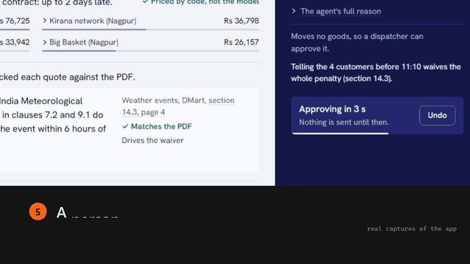
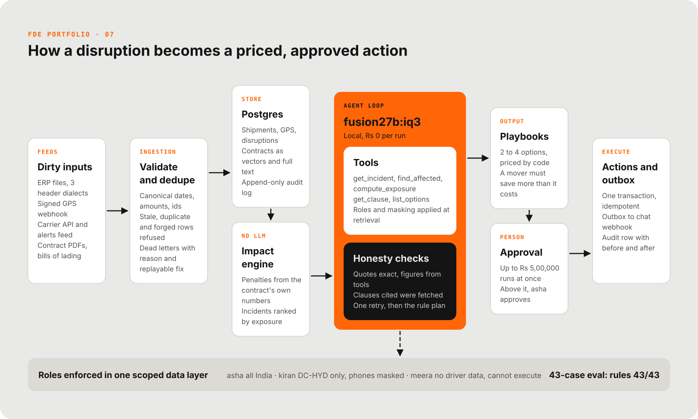
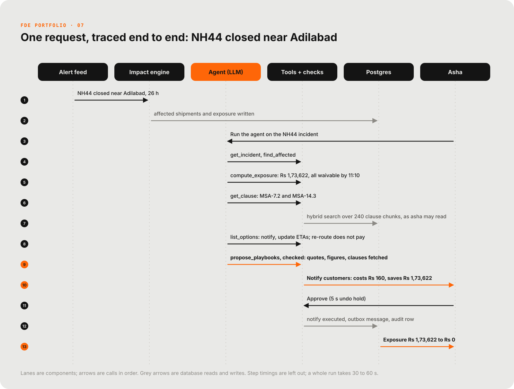

# Tarangini control tower

A control tower for **Tarangini Distribution**, a fictional Indian FMCG distributor with four distribution centres, 36 delivery cities, 40 suppliers, 200 SKUs and three trucking carriers. It takes in messy feeds (ERP files, GPS pings, carrier status, weather alerts) without losing or mangling data, ranks the day's disruptions by rupees at risk, and has a local-model agent triage each one from the customers' real contract clauses. A person approves any action that moves a lot of goods, and different staff see different data. It runs fully local: Python, Postgres, a 27B model through Ollama, a Next.js UI.

[](docs/media/reel.mp4)
<sub>Reel of the demo morning. Click for the full video.</sub>

| Agent pass rate | Honesty, and the same model without tools | Latency and cost per run |
|---|---|---|
| **43/43 (100%)**, agent run 7, the first run on the final code, on 43 triage cases. The 7 runs scored 40, 33, 40, 41, 43, 41, 43; the no-model rule plan is 43/43 by construction | **0** invented figures, out-of-scope details or unfetched clauses in the agent's final answers, in all 7 runs. The same model with no tools: **2/43 (5%)**, citing a clause it never fetched in 40 cases | **30.6 s and 33.8 s** median per case on a clean GPU (runs 5 and 6); 46.2 s in run 7, which shared the GPU. **Rs 0.00** on one local RTX 5080 |

Sources: `evals/report.md` (= `evals/report-2026-11-20-agent-run7.md`), the earlier per-run reports `evals/report-2026-11-19-agent-run1.md` to `evals/report-2026-11-19-agent-run6.md` (plus `-agent-run1-rules-run2` and `-agent-run6-notools-run2`), and `docs/chaos-drill.md`. The company and all data are synthetic. The engineering, the evaluation and the numbers are real.

## The problem
Tarangini has about 344 trucks and Rs 13.87 Cr of goods moving. Its feeds arrive dirty, a late truck can trigger contract penalties (and a weather waiver that expires in hours), and the person deciding needs the money, the clause and a fix in front of them at once. It must not lose a record, must not let an agent invent a clause or a number, and must cost nothing to run. Details: `docs/engagement.md`.

## Architecture


- **Nothing disappears.** A record the pipeline refuses goes to a dead-letter queue (a holding list) with a reason code, a plain reason and a suggested fix that can be replayed through the same checks. Operator actions go to an append-only audit log enforced by database triggers.
- **Money comes from code.** The impact engine computes each incident's delay and penalty from the contract's own numbers (clauses of the master services agreement: MSA-7.2 late delivery, 9.1 fill rate, 14.3 weather waiver). The model reads those figures; it does not make them.
- **Hybrid contract search.** Postgres full text and pgvector embeddings over 240 clause chunks from 12 contract PDFs, plus an exact lookup by clause id.
- **Honesty checks on the agent.** Code checks every quoted clause, rupee figure and shipment id; a draft that fails gets one retry, then a marked fallback to the rule plan.
- **Roles enforced in the data layer.** asha (VP Operations), kiran (Dispatcher South, one DC) and meera (Finance) get row filters and masked fields before data leaves the data layer, for every endpoint and every agent tool.
- **Approve before execute.** Up to Rs 5,00,000 of goods moved runs at once; above that it waits for asha. One transaction, outbox message, audit row, idempotent.
- **Circuit breakers.** A carrier that fails three polls in a row is marked open and left alone, then probed after a growing cooldown.

## One request, traced


## Results
**Evaluation** (`evals/`): 43 triage cases across weather, carrier, facility, supplier, roles, adversarial and honesty. Gold answers come from the deterministic engine and scoring is code only, with no LLM judge. Because gold is the engine's own output, the rule plan (no model) is the floor and scores 43/43 by construction. The question is whether the agent reaches that floor while reading the incident, fetching and quoting the exact clause and writing the brief.

| Variant | Passed | Median per case |
|---|---|---|
| Agent, run 7 (tools, honesty checks) | **43/43 (100%)** | 46.2 s (GPU shared; 30.6 s in run 5, 33.8 s in run 6) |
| Rules baseline (no model) | 43/43 by construction (37/43 before two rule-plan bugs were fixed) | 0.0 s |
| Same model, no tools (run 2; run 1 also 2/43) | 2/43 (5%); clause ids it never fetched in 40 cases | 11.3 s |

| Run | Agent | Fell back to the rule plan | Unfetched-clause catches | Median | Change made before the run |
|---|---|---|---|---|---|
| 1 | 40/43 | 5 | 13 | 38.3 s | First run |
| 2 | 33/43 | 12 | 9 | 35.8 s | Agent told to fetch only the clauses that apply (regression: it searched for them instead of fetching by id) |
| 3 | 40/43 | 5 | 7 | 33.6 s | Exact clause-id lookup; model-call budget 9 to 11 |
| 4 | 41/43 | 4 | 8 | 32.7 s | Rejection messages name the fix |
| 5 | 43/43 | 2 | 0 | 30.6 s | No clause id shown where it does not apply |
| 6 | 41/43 | 4 | 0 | 33.8 s | None (same code as run 5) |
| 7 | **43/43** | 2 | 0 | 46.2 s | One option per kind of action, picked by the engine |

- A "catch" is a draft the agent's own checks rejected before it reached anyone. Every failed case in every run was a fallback to the rule plan, never a wrong answer. The agent's final answers had 0 honesty failures in all 7 runs.
- Runs 5 and 6 ran the same code and differ by two cases, so one run moves by a case or two on its own. Run 7 is one run on the final code; the last three runs passed 127 of 129 case runs (98%).
- The owner stopped the eval runs at run 7. A run 8 was stopped part-way and archived; it is not a result.
- Run 7 shared the GPU with the owner for part of the run (the runner's GPU guard logged a pause), so runs 5 and 6 are the clean-GPU latency. About 14.6k prompt tokens over 6.6 model calls per case; a full run takes 22 to 35 minutes.
- No case or gold answer was changed to make a run pass.

**Chaos drill** (`docs/chaos-drill.md`, `python -m sim.drill`): a scripted bad morning in an isolated stack, no model. 158 bad ERP rows in, 155 dead letters filed, 3 repeats of an already filed payload: **0 lost, 0 duplicated**. Carriers were dropped and recovered and the tower was killed mid-burst. It found three faults, fixed at the cause: a stale circuit state after a restart; replays that moved the promised date of 8 shipments to an older one (now **0**); and no-ops counted as recoveries (70 reported, 28 really applied; replay results are now split into applied, unchanged, stale and failed).

## Run it
```
docker compose up -d db --wait
python scripts/dev.py          # Postgres, migrations, stages the morning, mock carrier API, tower :8500, UI :4400
```
`python` is the project's virtual environment (`pip install -e .` from `pyproject.toml`). Open http://127.0.0.1:4400/ (deep link to a case: `?incident=4`). Needs Docker Desktop and a `.env` (copy `.env.example`); `npm install` once in `web/`; Ollama with `fusion27b:iq3` and `nomic-embed-text` only to run the agent. Starting never calls the model. Full operations guide: `docs/runbook.md`.

```
python -m ruff check .
python -m pytest -q                   # LLM tests skipped unless CT_LLM_TESTS=1; DB tests skip if Postgres is down
python -m sim.drill                   # the chaos drill, about 2 minutes, no model
python -m evals.run --variant all --run-name run8   # needs the GPU; about 25 to 35 minutes for the agent variant
```

## Repository layout
| Path | What |
|---|---|
| `tower/` | the service: ingestion (erp, gps, carrier, alerts, replay), contracts, impact and exposure, agent, roles and scoped data layer, playbooks and actions |
| `sim/` | the chaos simulator, the demos and the chaos drill (`sim.drill`) |
| `web/` | Next.js UI; a server route holds the tokens so the browser never sees one |
| `evals/` | 43 cases, engine-derived gold, scoring, runner, one report per run |
| `docs/` | runbook, engagement write-up, chaos drill, data model, agent and access, diagrams |
| `db/`, `data/`, `tests/`, `scripts/` | schema and migrations, network data and inbox folders, pytest, the one-command launcher |

## Known limits
- The rule plan scores 100% because the gold is the engine's own output; the eval cannot say whether the engine's delay and cost model is right. Those are stated assumptions (straight-line lanes, fixed rupee rates).
- Incident exposures overlap, so they are not additive.
- One local GPU: 30 to 60 s per triage, one at a time. The model is not deterministic; the checks and the fallback bound what can come out, not how good it is.
- Static bearer tokens in `.env`, no TLS: local use only. The chat webhook is a mock. No real customers or feeds.

## How this was built
Built with Claude Code as a pair programmer. Scope, design decisions and verification are mine. Tarangini Distribution is fictional; all data is synthetic.

---

# Details by milestone

## What milestone 1 covers

The data model and a deliberately dirty ingestion pipeline. A simulator produces broken data on four channels and the
tower has to take it in without losing, duplicating or silently mangling anything.

| Channel | How it arrives | What goes wrong |
|---|---|---|
| ERP export | hourly CSV files in `data/inbox/erp/` | 3 header dialects, 4 date formats, lakh and rupee amounts, blank promised dates, unknown city codes, duplicate and conflicting rows, malformed lines, BOM, stray spaces |
| GPS webhook | `POST /ingest/gps`, HMAC signed | out-of-order, duplicate, future-dated and forged pings |
| Carrier status API | polled (mock on port 9100) | errors, latency, timeouts, outages (injectable at runtime) |
| Weather and incident alerts | polled JSON feed (same mock) | mixed severity vocabularies, repeated publication |

Rows the pipeline refuses go to a dead-letter queue with a machine reason code, a plain reason and a suggested fix
that can be replayed through the same validation. Operator actions are written to an append-only audit log.
See `docs/data-model.md` for the tables and the full catalogue of mess.

## What milestone 2 covers

PDFs in, incident impact, money at risk, a local-LLM triage agent, role-based access enforced at retrieval, and
approve-before-execute actions with an audit trail. Details, the exact delay and penalty numbers, and the known limits are in
`docs/agent-and-access.md`.

- **Contracts**: 12 master services agreement PDFs (one per chain, two layouts) are parsed into clause chunks with pgvector
  embeddings and full-text search; the numbers in the money clauses (MSA-7.2, 9.1, 14.3) are parsed from the PDF and checked
  against the contract master (a mismatch is logged and dead-lettered).
- **Bills of lading**: about 60 PDFs in `data/inbox/bol/`; driver and vehicle go onto the shipment (PII), 5 bad ones go to the
  dead-letter queue with a reason and a suggested fix.
- **Impact and money**: per incident, which shipments are hit and how late, and the penalty from the contract (1.5% a day capped at
  10%, 2% fill-rate, 6 hour force-majeure waiver). Incidents are ranked by exposure.
- **Triage agent** (`fusion27b:iq3` on Ollama): tools for incident, affected shipments, exposure, contract clauses, options; ends
  with 2 to 4 playbooks. Code checks every quote, rupee figure and shipment id; one retry, then a marked deterministic fallback.
- **Roles**: asha (VP Operations), kiran (Dispatcher South, DC-HYD only), meera (Finance). One scoped data layer for every
  endpoint and tool: row filter and field masking before data leaves it.
- **Actions**: up to Rs 5,00,000 of goods moved runs at once; above that it waits for asha. One transaction, outbox message to the
  chat webhook, audit row with before and after, idempotent.

## Running the milestone 1 and 2 demos

Needs the project's virtual environment, Docker Desktop, and a `.env` (copy `.env.example` and set every value,
including the three user tokens). Milestone 2 also needs Ollama running with `fusion27b:iq3` and `nomic-embed-text`. The
simulator draws its PDFs with reportlab: install it in the same environment, or point `CT_PDF_PYTHON` at an interpreter
that has it (the tower itself never imports it).

```
# 1. Postgres on 127.0.0.1:5436 (schema applied on first start)
docker compose up -d db --wait

# 2. Seed the network, customers and contracts (safe to rerun)
python -m tower.seed

# 3. The demo: resets the operational tables, starts the mock carrier API and the tower itself,
#    runs 05:00 to 10:40 IST in about 75 seconds with a live table, prints a summary, stops what it started
python -m sim.demo
```

`python` here is the venv's `Scripts\python.exe`. To run the pieces by hand instead (three terminals):

```
python -m sim.carrier_api        # mock carrier API and alerts feed, :9100
python -m tower                  # ingestion API and workers, :8500
python -m sim run --wall 75      # drive the scenario against them
```

### Milestone 2

```
python -m tower.migrate          # apply db/schema.sql and db/migrations/*.sql (idempotent; a fresh start runs both in order)
python -m sim contracts          # draw the 12 contract PDFs into data/contracts/
python -m tower.contracts        # parse, embed and verify them (about 30 s: 240 clause chunks)
python -m sim bols               # drop 60 bills of lading into data/inbox/bol/ (the tower's BOL worker picks them up)
python -m sim.demo2              # the whole story: ingest, impact, ranked incidents, 3 agent runs, kiran and meera views,
                                 # one action under the threshold and one approved above it, audit tail (about 8 minutes)
```

`sim.demo2` starts from the milestone 1 scenario state (it runs that scenario first when the database is empty), starts and
stops the carrier API and the tower itself, and sets the scenario clock to 10:40 IST. Calls use `Authorization: Bearer <token>`:

```
curl -H "Authorization: Bearer $CT_TOKEN_ASHA" http://127.0.0.1:8500/incidents
curl -X POST -H "Authorization: Bearer $CT_TOKEN_ASHA" http://127.0.0.1:8500/incidents/1/triage
curl -X POST -H "Authorization: Bearer $CT_TOKEN_KIRAN" http://127.0.0.1:8500/playbooks/3/run
```

Tests: `python -m pytest -q` (the LLM tests are skipped); set `CT_LLM_TESTS=1` first to also run the two that call the real model.

Other commands: `python -m sim erp-file 7` (drop one ERP export), `python -m sim faults C2 --outage` (inject a
carrier fault; `--clear` removes them), `python -m pytest -q`, `python -m ruff check .`.

Read endpoints need a bearer token since milestone 2 (`GET /health` stays open): `/me`, `/incidents`,
`/incidents/{id}/brief`, `/shipments?dc=DC-HYD`, `/disruptions`, `/network`, `/audit`, `/health/feeds`, and `/dead-letters`
(VP Operations only). Actions: `POST /incidents/{id}/triage`, `POST /playbooks/{id}/run`, `POST /playbooks/{id}/approve`.
Admin endpoints keep `X-Admin-Key` (value in `.env`): `POST /dead-letters/{id}/replay` (optional body `{"payload": {...}}`
with corrected fields), `POST /dead-letters/{id}/discard`, `GET /audit-log`.

## What milestone 3 covers

The control tower UI (`web/`, Next.js 16 App Router, TypeScript) on the real API. Remade 2026-11-18 for a portfolio
visitor with 60 seconds (layout and look picked by Daman from mockups in `.design/v2/`; the design record is `DESIGN.md`,
product truth `PRODUCT.md`; the first build is archived in `web/archive/`):

- **One case at a time.** A strip of the six incidents ranked by money at risk; a paper sheet holding the selected case in
  four stages (caught, priced, contract, decision); a decision rail on the indigo with the amount at risk, the deadline
  countdown on the scenario clock, a live preview of the selected fix ("Rs 1,73,622 at risk -> Rs 0 after this fix,
  costs Rs 160") and Approve.
- **Interactive evidence.** "Watch the agent work" replays the real recorded run step by step; customers in "priced" light
  their trucks on the locator map and open per-shipment penalties; the quoted clause lights the figures it drives; the
  map has truck tooltips and warehouse lanes; the shipment list shows driver data exactly as each role may see it.
- **Data health** (feeds, records waiting with their suggested fix, replay and discard, the Outage switch) and **Audit**
  (this morning's actions, newest first) in the same look; "View as" asha, kiran or meera.
- **Scales with the window**: every size is in rem on a root of 1/96 of the viewport (15 px at 1440, 20 at 1920, capped at
  24), so wide screens show the same composition larger. Fonts are self-hosted (Anek Latin, Hanken Grotesk).

- **Tokens stay on the server.** The browser calls `/api/...`; a Next route handler attaches the bearer token of the
  selected role (read from the project `.env`) and forwards to the tower on :8500. Only the endpoints the UI uses pass.
  The UI shows exactly what the API returns for the role: kiran's masked phones and his 404 on incidents outside DC-HYD,
  meera's removed driver fields and her 403 on running a playbook, the 403 on dead letters for both.
- **Run the agent** calls `POST /incidents/{id}/triage` (40 to 60 s on the local model): the case shows the elapsed time,
  nothing invented, then the real steps, timings and tokens. **Playbooks** run or ask for approval (above Rs 5,00,000), and
  asha approves from the same row. **Dead letters** are replayed or discarded from Data health.
- **New endpoints** (all need a bearer token, tests in `tests/test_ui_api_db.py`): `GET /live` (trucks still on the road
  with a risk status, executed plans, carrier circuits, the dead-letter count for VP Operations; scoped like every read),
  `GET /outage` and `POST /outage {"on": true|false}` (VP Operations only; asks the simulator for 30% carrier API failures
  and drops one malformed ERP export, `POST /admin/erp-malformed` on the mock; audit row `sim.outage`). Dead-letter replay and
  discard now also accept the bearer token of a user who may read the queue (asha), as well as the admin key.
- `GET /audit?morning=true` returns only the current scenario morning (after the latest staging marker, nothing after the
  clock). No external requests at runtime.

### Start it

```
python scripts/dev.py      # flags: --stage --fresh --prod --no-web --no-llm
```

`.\scripts\dev.ps1` wraps the same command, but Windows blocks unsigned scripts by default; run it as
`powershell -ExecutionPolicy Bypass -File scripts\dev.ps1` if you prefer it.

One command: checks Postgres (starts it with docker compose if needed), applies the migrations, stages the morning when the
database has none (the milestone 2 demo's own steps `sim.demo2.prepare` and `sim.demo2.stage`: the 05:00 to 10:40 scenario,
contracts, bills of lading, impact and exposure; no model calls), sets the scenario clock to 10:40 IST, then starts the
mock carrier API, the tower and the UI on http://127.0.0.1:4400/. Ctrl+C stops what it started. `-Stage` restages,
`-Fresh` reruns the milestone 1 scenario first, `-Prod` uses `next build` and `next start`, `-NoLlm` makes no Ollama call
while starting (a restaged contract whose PDF changed is stored without embeddings; retrieval then uses full text). Starting never runs the triage agent; the briefs
show the agent runs already in the database, and "Run the agent" in a case is the only thing that calls the model. First time only: `npm install`
in `web/`. Deep link to a case: `http://127.0.0.1:4400/?incident=4`.

Checks: `npm run lint`, `npm run typecheck`, `npm run build` in `web/`; `node scripts/shots.mjs` there writes the proof
screenshots (every view for every role at 1440, 1920, 2560 and 375 px, plus the interactions) to `web/.shots/`.

## What milestone 4 covers

The evaluation of the triage agent (`evals/`) and the chaos drill; results are at the top and in `docs/engagement.md` (sections 4 and 5). Gold comes from the deterministic engine (`evals/gold.py`), scoring is code only (`evals/scoring.py`), and each case is a small world built in a throwaway `ct_eval` database (never the live `ct`). Three variants: `agent` (the real triage), `rules` (the fallback plan, no model) and `notools` (the same model given only the incident text and the affected shipments).

```
python -m evals.build_cases                       # rebuild worlds and gold (only after a deliberate engine change)
python -m evals.run --variant rules --run-name run3    # baseline 1, no GPU, under a minute
python -m evals.run --variant agent --run-name run8    # the agent, about 45 s a case on fusion27b:iq3
python -m evals.run --variant notools --run-name run3  # baseline 2, about 12 s a case
python -m evals.run --report-only                 # rebuild evals/report.md from the latest results per variant
```

Results go to `evals/results/<run-name>-<variant>.jsonl` (not committed); rerun with the same `--run-name` to resume. Before every model case a GPU guard reads `nvidia-smi` and waits while the owner is using the GPU (stops cleanly after 20 minutes). `evals/report.md` is rewritten after every run, and a dated copy named from the runs it holds (`evals/report-2026-11-20-agent-run7.md`) is written once all three variants have a full run. Chaos drill: `python -m sim.drill` (`docs/chaos-drill.md`).
